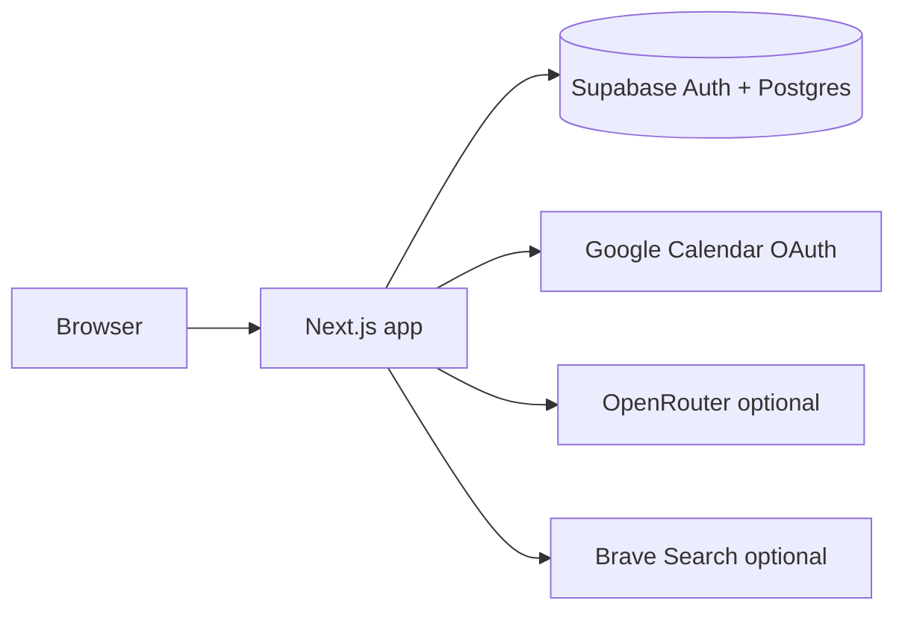

# Self-host Keeply

Run Keeply on your own Supabase project, Google Cloud OAuth clients, and hosting (Vercel or any Node host). Managed hosting from the project maintainers is planned for later; this guide is the supported path for the open-source tree.

Billing and a hosted tier are out of scope here. You bring your own Supabase, OpenRouter, Brave Search, and Google OAuth credentials via `.env.local` or your host's environment variables.

## Overview



Keeply needs **two separate Google OAuth Web clients**:

1. **Calendar client** — redirect URI `https://<your-domain>/auth/google/callback` (or `http://localhost:3000/auth/google/callback` locally). Used only for Calendar access after Approval.
2. **Supabase Google provider client** — redirect URI `https://<your-project-ref>.supabase.co/auth/v1/callback`. Used only for Sign in with Google in Supabase Auth.

Do not mix redirect URIs between the two clients.

## 1. Supabase

1. Create a project at [supabase.com](https://supabase.com) and note the **project ref** (`<your-project-ref>`).
2. Apply schema: link the CLI (`supabase link --project-ref <your-project-ref>`) and run `supabase db push`, or paste each file under `supabase/migrations/` into the SQL Editor in order.
3. **Authentication → Sign In / Providers**
   - Enable **Anonymous sign-ins** (required for the MVP flow without forcing Google first).
   - Enable **Google** with the **Supabase** OAuth client (client id + secret from Google Cloud; redirect URI must be `https://<your-project-ref>.supabase.co/auth/v1/callback`).
   - Enable **Manual linking** so anonymous visitors keep their plans when they sign in with Google.
4. **Authentication → URL Configuration**
   - Set **Site URL** to your deployed origin (e.g. `https://keeply.example` or `http://localhost:3000`).
   - Add the same URL(s) under **Redirect URLs** (include preview domains if you use Vercel previews).

Copy **Project URL** and **anon key** from Project Settings → API into env vars below.

Optional: set GitHub Actions secrets `SUPABASE_URL` and `SUPABASE_ANON_KEY` if you use `.github/workflows/supabase-keepalive.yml` to reduce free-tier pause risk (`docs/environments.md`).

## 2. Google Cloud (Calendar + Supabase login)

1. Create or select a project in [Google Cloud Console](https://console.cloud.google.com/).
2. Enable **Google Calendar API**.
3. Configure the **OAuth consent screen** (External is fine; add test users while in Testing mode).
4. Create **OAuth client 1 — Calendar**
   - Type: Web application.
   - Authorized redirect URI: `https://<your-domain>/auth/google/callback` (and `http://localhost:3000/auth/google/callback` for local dev).
   - Scope used by Keeply: `https://www.googleapis.com/auth/calendar.events` only.
5. Create **OAuth client 2 — Supabase Google provider**
   - Type: Web application.
   - Authorized redirect URI: `https://<your-project-ref>.supabase.co/auth/v1/callback` only.
   - Paste this client's id and secret into Supabase → Authentication → Google provider (step 1.3).

## 3. Third-party API keys (optional)

| Service | Required for | If unset |
|---|---|---|
| [OpenRouter](https://openrouter.ai/) | Label photo AI and manual PDF extraction | **Manual** path: owner types appliance details; no AI label read or manual extraction |
| [Brave Search](https://api.search.brave.com/) | Automatic manufacturer manual search | Search returns unavailable; dishwashers may still get general guidance |

Set `OPENROUTER_API_KEY` and `BRAVE_SEARCH_API_KEY` only on the server (never `NEXT_PUBLIC_*`).

## 4. Environment variables

Copy `.env.example` to `.env.local` for local dev, or set the same names on Vercel / your Node host.

### Required for persistence + calendar (typical self-host)

| Variable | Notes |
|---|---|
| `NEXT_PUBLIC_SUPABASE_URL` | Supabase project URL |
| `NEXT_PUBLIC_SUPABASE_ANON_KEY` | Anon public key |
| `GOOGLE_CLIENT_ID` | Calendar OAuth client id |
| `GOOGLE_CLIENT_SECRET` | Calendar OAuth client secret |
| `GOOGLE_REDIRECT_URI` | Must match a registered Calendar redirect URI, e.g. `https://<your-domain>/auth/google/callback` |

### Optional — scanning and search

| Variable | Notes |
|---|---|
| `NEXT_PUBLIC_KEEPLY_SCAN` | Set to `1` at **build time** to enable the scan UI and `/api/identify` |
| `OPENROUTER_API_KEY` | Enables AI; omit for Manual-only |
| `OPENROUTER_MODEL` | Defaults to `openrouter/free` |
| `OPENROUTER_DATA_COLLECTION` | `deny` (default) or `allow` |
| `BRAVE_SEARCH_API_KEY` | Enables manual search |
| `SUPABASE_SERVICE_ROLE_KEY` | Server only; durable Brave quota in Supabase (without it, quota check is skipped) |
| `BRAVE_FREE_QUOTA_PER_MONTH` | Default 2000; override only for tests |
| `KEEPLY_SCAN_ACCESS` | See below |

### Manual-only path (no OpenRouter, no Brave)

Leave `OPENROUTER_API_KEY` and `BRAVE_SEARCH_API_KEY` unset. The owner adds appliances by typing details (`/appliances/new`). Plan search cannot fetch manuals; dishwashers may still receive the built-in general-guidance list. Approval and Google Calendar still work when Google and Supabase env vars are set.

You do **not** need `NEXT_PUBLIC_KEEPLY_SCAN=1` unless you want the scan entry point; with scanning off, the typed flow remains available.

### `KEEPLY_SCAN_ACCESS`

Server-only gate for billable AI scans (`src/app/api/scan-access`).

| Value | Use when |
|---|---|
| `invite` (default) | **Public or shared deployments.** Anonymous users need a redeemed invite; signed-in Google users follow Supabase `scan_limits`. |
| `open` | **Local machine only** or a preview behind login — never on a URL anyone on the internet can hit without authentication. Anyone who can reach the server can trigger AI scans. |

For local development with real keys on `localhost`, `open` is convenient. For any deployment others can access, keep the default `invite` and use `docs/testers.md` for invite codes.

## 5. Run locally

```bash
pnpm install
cp .env.example .env.local   # fill in values
pnpm dev                     # http://localhost:3000
```

Without Supabase vars, plans stay in the browser on that device. Without Google vars, Approval saves locally without calendar writes.

## 6. Deploy

### Option A — Vercel

1. Import the GitHub repository.
2. Set environment variables from the tables above for Production (and Preview if you use previews).
3. Redeploy after changing any `NEXT_PUBLIC_*` variable (build-time).
4. Add preview and production URLs to Supabase redirect allowlists.

### Option B — Node (any host)

```bash
pnpm install
pnpm build
pnpm start                    # default port 3000; set PORT if needed
```

Run behind HTTPS in production. Set the same env vars as Vercel. Use a process manager (systemd, Docker, etc.) of your choice.

## 7. Verify

1. Anonymous session: add an appliance, reload — data persists when Supabase is configured.
2. Approval: connect Google Calendar and approve a plan — recurring event appears in Calendar.
3. Optional AI: with keys set and `NEXT_PUBLIC_KEEPLY_SCAN=1`, run a private scan test (`docs/live-testing.md`).
4. Record manual checks in the template at `docs/live-gates.md`.

Automated checks: `pnpm verify`, `pnpm build && pnpm e2e` (no live keys in CI — see `docs/ci.md`).

## Further reading

- Setting names and locations: `docs/environments.md`
- Product rules and evidence model: `docs/HANDOFF.md`
- Invite-based scanning limits: `docs/testers.md`
